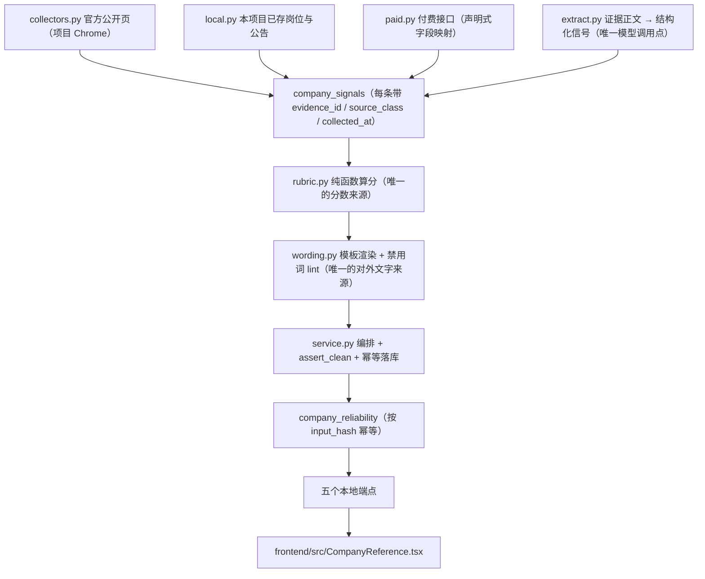

# 公司求职参考分析（Company Reliability）设计

日期：2026-11-09。分支 `codex/company-reliability`，实现基线 `9b98099`（Task 1-11）加本次边界自检与文档（Task 12）。**2026-11-10 按 P1 交付后的现状修订**（P1 规格见 `docs/plans/2026-11-10-company-reliability-p1.md`，落地偏差见其文末「实施修正记录」）。本文照当前代码写，不照计划正文写：计划正文里有几处写法在实施修正记录里已被推翻，凡是与本文不一致的地方以代码与本文为准。

计划原文见 `docs/plans/2026-11-09-company-reliability.md`；实测状态与未验证清单见 `docs/validation/jobscope-company-reliability.md`。

## 这个功能解决什么问题

在岗位档案里，围绕某一家公司把「本机已经存下的材料」整理成一份可读、可回查、可复现的参考：哪些是官方登记数字、哪些是自己算出来的覆盖度、哪些是别人的一句自述。它回答的是「我手上有材料能说明什么」，不回答「这家公司好不好」。

一句话定位：**本地单人自用的情报整理**。因此整个功能的形态被钉死为不出网、不分享、不排名。

## 四层管线

**取数层（四种互不越界的通路，端点按登记表里的 `transport` 分派）**

- `collectors.py`（`transport='browser_page'`）：复用 `jobscope/browser.py` 的项目 Chrome——同一个 `profile` 目录、同一份端口记录、同一把 OS 会话锁。硬上限写死在模块里：单次任务最多 5 页、页间间隔 2.5 秒、单页超时 25 秒；不重试、不换 UA、不绕风控。命中 `VERIFY_MARKERS` 里的字样就退成 `needs_verification`，并把标签页留在前台交给用户（只有干净收尾才关标签页）。会话被占用退成 `backoff`，没有可用端口退成 `needs_login`。目前 `READERS` 只登记了 `gsxt` 一个来源。
- `local.py`（`transport='local'`）：只读本项目已存数据，不联网、不占会话锁。P1 起计算五条规则：两条材料计数（`salary_quote_coverage`、`disclosure_available`）、两条统计规则（`pay_vs_city_median` 与 `jd_specificity`，统计量由 `job_stats.py` 从已存岗位行算出）与一条行业媒体计数（`industry_media_count`）。落成信号时 `source_class='platform'`、`url=''`、`observed_at=''`，证据 kind 取 `local_computation`——必须落在公告类 kind 之外，否则下一次采集会把自己写的口径记录再数一遍，计数随点击无限膨胀。
- `job_stats.py`（P1 新增，`local.py` 的统计层）：纯函数 + 只读仓储查询。城市归一只做「命中已知城市词典（复用 `connectors.CITY_CODES`）就归一，否则按 `normalise_name` 后的原文精确分组」，不做模糊匹配、不做「周边城市并入」。它只交原始统计量（中位数、均值、计数与**不带时刻**的口径说明），闸门与分档全部在 `rubric` 的 scorer 里；公司没有岗位时不产信号，有岗位但无可解析报价时交全零统计量，让闸门缺口说清样本不够。
- `paid.py`（`transport='http_api'`）：只在用户自备密钥并启用后才发起一次 GET。字段名一律来自 `sources.SIGNAL_SOURCES[id]['fields']` 那份声明表，键名去掉大小写与 `_ - / 空格` 后**精确匹配**，不做子串或模糊匹配；同名字段在响应里给出多个不同值时直接拒绝取值并把值报回 message；日期只接受日期字符串，不接受 epoch 或 `20150401`。对不上就一条信号都不产出，并把试过的候选字段名逐个写回 message。取数结果落成 `paid_api_record` 类证据，同样不进抽取器的材料列表。接口地址里出现密钥直接拒绝（否则密钥会跟着出处 URL 永久留档）。

`collectors.years_since()` 是全项目唯一的一把年数尺子（`round(days / 365.25, 1)`），浏览器与付费两条通路都用它，避免两处漂移。

**信号层**：`models.SignalInput` 是唯一入仓契约（`extra='forbid'`），每条必须带 `evidence_id`、`dimension`、`rule`、数值 `value`、`source_class` 与 `collected_at`。`repository.signals()` 每条规则只保留最新一条，并用 `rubric.RULES[*].ttl_days` 标记过期（`stale`）——过期不是删掉，是「仍然展示文字，但不进加权」，并在维度 `missing` 里写明「已过期，超出 N 天」。**正因每条规则只留最新一条，跨多条材料的聚合必须发生在落库前**：`team_size_statement` 由抽取端代码把同批抽出的多条自述合成一条 `{median_size, statements, compatible}`（模型只交原始数字 `{"size": N}`，区间另加 `"size_max"`；相容判定按区间相容——点值落在自述区间内即相容，两条点值看 ≤2.5 倍，区间宽度本身永不扣分；锚条证据编号承载出处，其余参与编号写进任务 message 留档）。

**模型层只出现在 `extract.py`**：输入是证据正文（单条正文截到 12000 字符、最多 40 条、`temperature=0`），输出经 `ExtractInput`/`RawSignal` 校验。材料清单 = 该公司的非岗位材料 + **完整 JD 的岗位证据**（P1 起 `team_size_statement` 要从岗位描述里抽「团队 N 人」；只有 `description_status == 'complete'` 的岗位进材料，列表摘要照样不进）。这一层是 fail-closed 的：结构解析不出来就整批作废并留档原始响应（`status='degraded'`）；模型多塞 `score`/`grade`/`rating`/`verdict` 一类字段会让整批作废；`value` 里只保留数字，字符串与布尔一律剔除，剔空则丢弃该条；`evidence_id` 不在传入证据里就丢弃；网络异常归 `failed`；未配置模型归 `skipped`，并在 `tasks` 里如实记下真实状态。规则清单由 `rubric.RULES` 自动生成，`extract_hint` 字段按规则声明 value 字段名与取数约束（如「current 与 previous 必须来自同一份公告」）。`KIND_TO_SOURCE_CLASS` 决定证据 kind 映射到哪个 `source_class`，员工自述与媒体报道映射成 `employee`/`media`，因此天然不能单独结算一个维度。

## 六维权重

`rubric.DIMENSIONS`（权重合计 1.00，P1 未动）：

| 维度 | 标签 | 权重 | 现在能出分吗 |
| --- | --- | --- | --- |
| `stability` | 稳定性 | 0.22 | 能（3 条 assessment 规则，其中 2 条依赖未实测的 gsxt） |
| `pay` | 薪资待遇 | 0.20 | 能（P1：同城报价中位数对比，样本闸门公司 ≥3 条、同城 ≥20 条） |
| `operations` | 实际经营 | 0.18 | 能（P1：公告营收/在职人数同比，需要同一份公告的两期数字） |
| `people` | 人员情况 | 0.16 | 能（P1：团队规模自述的一致程度，≥2 条自述才判） |
| `professional` | 专业性 | 0.12 | 能（P1：完整 JD 的描述具体程度，≥3 条才判） |
| `industry` | 行业前景 | 0.12 | **不能，刻意不出分**：没有可信公开源，只有 1 条 material 登记规则 |

## 规则清单

`rubric.RULES`，`RUBRIC_VERSION = 'rubric-3'`。所有规则的 `weight` 目前都是 1.0（维度内按观察到的规则数归一），差别全在 `kind`。每条规则带 `gate_note`（scorer 返回 None 时缺口文案说清缺了什么，不再是笼统的「数字不足」）。

| 规则 | 维度 | 单位 | `ttl_days` | `kind` | 模板 | 取值口径 |
| --- | --- | --- | --- | --- | --- | --- |
| `company_age` | stability | 年 | 365 | assessment | `company_age` | `min(1, years / 10)` |
| `insured_headcount_trend` | stability | 人 | 400 | assessment | `headcount_trend` | `0.5 + (after - before) / max(before, 1) / 2`，截到 0-1 |
| `judicial_case_ratio` | stability | 件/万人 | 180 | assessment | `judicial_cases` | 分档：≥25→0.3、≥10→0.55、≥3→0.75、其余 0.9；`ratio` 为 0 或缺失时**返回 None** |
| `pay_vs_city_median`（P1） | pay | 元 | 90 | assessment | `pay_vs_city_median` | 公司可解析人民币月薪报价中位数 ÷ 同城全部已存岗位中位数；闸门：公司 ≥3 条、同城 ≥20 条、两组中位数 > 0；分档 ≥1.2→0.95、≥1.0→0.8、≥0.85→0.6、≥0.7→0.45、其余 0.3。模板写死「报价对比不是到手薪资，同城样本不是同职级同技能样本」 |
| `jd_specificity`（P1） | professional | 条 | 180 | assessment | `jd_specificity` | 只统计完整 JD；描述均长（/600）、职责条目均数（/8）、技术栈命中均数（/8）、量化结果条目占比 四项归一后加权 0.25/0.30/0.25/0.20；闸门 jobs ≥ 3。量的是「把要做什么讲清楚没有」，不是技术实力 |
| `team_size_statement`（P1） | people | 人 | 240 | assessment | `team_size_statement` | 抽取端聚合的多条规模自述：分数 = 最大相互兼容自述子集占比（全相容→0.9、≥2/3→0.6、否则 0.3）；闸门 statements ≥ 2。相容按区间判定（点值在自述区间内即相容；两条点值 ≤2.5 倍相容），**与规模大小无关** |
| `disclosure_revenue_trend`（P1） | operations | 元 | 365 | assessment | `disclosure_revenue_trend` | 同一份公告里本期与上期营收的同比；闸门 previous > 0；分档 ≥0.2→0.95、≥0.05→0.8、≥-0.05→0.65、≥-0.2→0.45、其余 0.25 |
| `disclosure_headcount_trend`（P1） | operations | 人 | 365 | assessment | `disclosure_headcount_trend` | 同上，字段是公告口径在职人数；模板严禁「裁员」「裁撤」，固定写法「不推断经营好坏，也不据此判断招聘冻结」 |
| `salary_quote_coverage` | pay | % | 120 | **material** | `salary_quote_coverage` | `known / total` |
| `employee_review_sample` | people | 条 | 180 | **material** | `employee_review_sample` | `min(1, samples / 10)` |
| `disclosure_available` | operations | 份 | 365 | **material** | `disclosure_available` | `min(1, count / 4)` |
| `industry_media_count`（P1） | industry | 条 | 365 | **material** | `industry_media_count` | 只数 `media_report` + `announcement` 两类证据条数；行业前景没有可评价依据，这句话只把维度从「什么都没有」变成「有材料但评不了」 |

三条分类纪律：

- **assessment 才有资格产出维度分；material 只产出说明文字。** material 规则衡量的是本项目手上有多少材料——把「9/10 条岗位能解析出月薪」算成薪资待遇 90 分，用户读到的是「这家薪资给得好」，属于静默谎言。
- **`ReportFinding.kind == 'material'` 时 `score` 一律为 `None`**（`service._report_finding()` 强制）。`RuleFinding.score` 仍在 rubric 内部参与加权，但出到 API 就是 null；前端渲染 material 行时只画文字与出处，不画数字。
- **R4/R5 刻意拆成两条规则**而不是用 `metric` 字符串参数区分：`_for_signal()` 只保留数字字段，字符串塞不进去——这是 P0 的实现事实，不为新规则改它。

## 算分与置信度

- 单维度分 = 该维度**可独立成立**（`can_stand_alone`：`official`/`paid_api`/`platform`/`user_material`）的 assessment 依据按 `weight` 加权平均，`round(…, 1)`。
- 单维度 `confidence` = `min(1, 权重合计 / 该维度 assessment 规则条数)`，也就是「这个维度的可评价规则覆盖了几条」。
- 综合分 = 有分的维度按其权重再归一；综合 `confidence` 是这些权重之和，前端与措辞里都称「维度覆盖 {n}%（按权重）」，它和单维度 `confidence` 不是一回事。
- 没有任何 assessment 规则可算时 `score=None`、`confidence=0`，并且**每个维度都必须自己解释为什么没分**：有 assessment 规则但缺数据列「（尚无来源）」，一条 assessment 规则都没有列「该维度还没有可评价的规则，下面只是已收集到的材料」，只有自述材料列「仅有未经独立核实的自述材料，不计入分数」。空维度不留空白。

## 措辞模板与禁用词

`wording.py`（`WORDING_VERSION = 'wording-3'`）是唯一产生对外文字的地方，模板键与 `RULES[*].template` 纯靠字符串对齐，由测试抓拼写漂移。P1 起新增六条模板，口径声明写死在句子里：

| 模板 | 文案 |
| --- | --- |
| `company_age` | 登记信息显示成立约 {years} 年（来源见出处）。 |
| `headcount_trend` | 公开年报的参保人数由 {before} 人变为 {after} 人；原因可能有多种，本工具不推断经营好坏。 |
| `judicial_cases` | 公开裁判信息中相关案件约 {ratio} 件/万人参保规模；涉诉数量与用工质量没有既定关系，请结合案由自行判断。 |
| `salary_quote_coverage` | 该公司已保存岗位中 {known}/{total} 条能解析出人民币月薪区间，其余报价口径不支持。 |
| `employee_review_sample` | 收集到 {samples} 条员工自述材料，属个人经历陈述。 |
| `disclosure_available` | 已保存 {count} 份公开公告元信息，正文是否已解析以出处标记为准。 |
| `pay_vs_city_median` | 本公司 {company_jobs} 条已存岗位的可解析人民币月薪报价中位数约 {company_median} 元，同城 {city_jobs} 条已存岗位的中位数约 {city_median} 元（比值 {ratio}）；这是招聘平台报价的对比，不是实际到手薪资，不含奖金与股票，同城样本也不等于同职级同技能样本。 |
| `jd_specificity` | 该公司 {jobs} 条完整岗位描述平均 {chars_mean} 字，职责或要求条目平均 {items_mean} 条，可识别技术栈平均 {skills_mean} 项，含量化结果的条目占比 {quantified_share}；这衡量岗位描述把要做什么讲得有多具体，不代表公司技术实力。 |
| `team_size_statement` | 岗位与公司自述材料给出的团队规模中位数约 {median_size} 人（{statements} 条自述中 {compatible} 条相互兼容）；规模属公司口径的自述，未见独立核实，分数量的是这些自述之间是否一致，不评价规模好坏，也不说明团队氛围。 |
| `disclosure_revenue_trend` | 同一份公告里本期营业收入或营收数字为 {current}、上一期为 {previous}；同比由固定规则换算，营收变动有多种成因，本工具不推断经营好坏。 |
| `disclosure_headcount_trend` | 公告口径在职员工数由 {previous} 变为 {current}；人数变动有多种成因，本工具不推断经营好坏，也不据此判断招聘冻结。 |
| `industry_media_count` | 已保存 {count} 条该公司相关的行业与媒体材料（媒体报道、公告）；本工具没有可评价行业前景的依据，这些材料只作背景阅读。 |

模板不添数字自己的口径之外的单位后缀：公告营收数字自带万元/亿元口径，R4 模板因此不带「元」；R5 的固定写法保证「裁员」「裁撤」（都在禁用词表）永远触不到。

- 分数区间只描述「材料说明了什么」：≥75 稳定信号偏多；≥60 偏向中性、仍有维度缺少依据；≥45 手上的材料方向不一致、请逐条对照依据；<45 才要求重点核实。45-60 那段以前写成「出现了值得你重点核实的信号」，一家成立 2 年却在扩员的公司拿 55.6 分会被这样描述，属于文案说谎。
- 无综合分时用 `UNKNOWN_OVERALL`（「可纳入计算的公开依据不足，暂不给出综合参考分」），不画空环、不摆占位数字。
- `employee`/`media` 类依据的句子结尾固定追加 `（来自个人自述，未见独立核实）`，这是措辞上限，UI 不展示作者、ID 或截图粒度。
- `BANNED` 禁用词表（22 项）：欠薪、拖欠工资、黑心、血汗、骗子、诈骗、皮包公司、跑路、老赖、倒闭、裁员、裁撤、垃圾、坑、无良、高危、高风险、危险、不良、劣迹、信誉差、不靠谱。这些词把可核实的数字升级成对他人商誉的断言。
- `assert_clean()` 在 service 里每次都跑：任何一句命中禁用词、任何一条依据缺 `evidence_id`，直接抛 `ValueError`，端点转成 422，宁可不出报告也不出违规报告。

## 来源登记表

`sources.py` 的 `SIGNAL_SOURCES`（默认值只由 `tier` 推导，登记表里没有一条写死的 `mode`）：

| 来源 | 名称 | 层级 | transport | 默认 | `status` | 覆盖规则 |
| --- | --- | --- | --- | --- | --- | --- |
| `gsxt` | 国家企业信用信息公示系统 | free | browser_page | 启用 | `needs_verification` | company_age、insured_headcount_trend |
| `credit_china` | 信用中国 | free | browser_page | 启用 | `needs_verification` | judicial_case_ratio（尚无 reader） |
| `court_records` | 中国裁判文书网 | free | browser_page | 启用 | `needs_verification` | judicial_case_ratio（尚无 reader） |
| `jobscope_jobs` | 已保存岗位与证据 | free | local | 启用 | `available` | salary_quote_coverage、disclosure_available、pay_vs_city_median、jd_specificity、industry_media_count（P1） |
| `qcc` | 企查查开放平台 | paid | http_api | **关闭** | `opt_in` | 三条 stability 规则 + pay_vs_city_median、disclosure_revenue_trend、disclosure_headcount_trend（P1 起的候选映射，全部仍是待校正假设） |
| `tyc` | 天眼查开放平台 | paid | http_api | **关闭** | `opt_in` | 同 qcc |

密钥做法与 `ModelSettings` 一致：存本机 SQLite 的 `signal_sources` 表、`public()` 的返回结构里根本没有 `key` 字段（只有 `key_set` 布尔）、换服务地址必须重填密钥、付费来源没有密钥即使 `mode='enabled'` 也不算启用。闸门语义统一走 `sources.enabled(id)`：免费来源被手动关闭同样返回 False。

`status` 的词汇沿用 `connectors.result()` 那套（`completed`/`partial`/`needs_login`/`needs_verification`/`backoff`/`unsupported`），前端 Badge 不用加分支。

## 法律边界的四条约束

1. **对外文字只能来自 `wording.py` 的模板**，`rubric_version` / `wording_version` / `disclaimer_version` 随分数一起落库，事后能复现当初那句话是怎么写的。
2. **数字代替形容词、来源代替结论**：涉诉、参保下降这类事实只陈述「数字 + 来源 + 抓取时间」，不生成定性断言，禁用词表由测试 lint。
3. **`employee` 类信号（脉脉、看准网等自述）不得单独产生负面维度分**：必须与 `official`/`platform` 类共同出现才参与加权，措辞上限锁死为「未见独立核实」，UI 不展示作者、ID、截图粒度。
4. **不做对外分享页、不做公开 API、不做公司红黑榜或跨公司排名**。

外加一条实体纪律：**不做模糊合并**。公司归一只做全角/空白/标点规范化（删除所有空白）与显式别名表，强键是统一社会信用代码；宁可漏合并，也不把 A 公司的诉讼挂到 B 公司头上。

## 明确不做

- 分享页、公开只读端点、榜单/排名/评级接口（Task 12 的 `backend/tests/test_reliability_boundaries.py` 直接扫应用路由表，路径里出现 `share`/`rank`/`public`/`leaderboard`/`blacklist`/`rating`/`scoreboard`/`compare` 任一子串即变红，并断言本功能的对外面就只有那五个路径）。
- 自动重试、换 UA、绕验证码或风控；命中校验就把页面交还用户。
- 代持付费密钥、默认调用付费接口、从任意 JSON 里「挑一个像参保人数的数字」。
- 让模型算分：分数只在 `rubric.py` 产生，`rubric`/`wording` 除 `.models` 与 `dataclasses` 外不导入任何东西，`RuleFinding` 只由 rubric 构造，`extract.py` 是唯一被允许调用模型层的模块。
- 把「没查到负面」写成「好」。

## 当前 P1 的真实能力边界（重要）

- **五个维度能被打分，`industry` 刻意不能。** P1 之后 `pay`/`professional`/`people`/`operations` 各有一条本地即可评估的 assessment 规则（`pay`、`professional` 由已存岗位直接算，`people`、`operations` 需要抽取或付费/浏览器采集先落信号）；`industry` 没有可信公开源，只有 material 登记，不造分数。
- `stability` 的三条 assessment 规则仍全部依赖还没实测的 gsxt / 裁判网通路；付费接口的字段映射与认证方式同样未经核实。已存岗位 + 公告充足时，真实用户能拿到 `pay` 与 `professional` 的分数和综合分（覆盖 0.32），其余维度按闸门如实说明缺口。
- **缺数据一律不出分**：样本闸门不满足（公司 <3 条报价、同城 <20 条、自述 <2 条、上期 ≤0、完整 JD <3 条）、数值不完整、只有自述材料、规则已过期——都退回 `missing` 并按 `gate_note` 说清缺了什么，而不是分数。

## 失败模式一览

| 情况 | 表现 |
| --- | --- |
| 未配置模型 | `extract` 退 `skipped`，报告照常可算 |
| 模型返回不可解析结构 | `degraded`，整批作废并留档原始响应 |
| 模型/网络异常 | `failed`，`message` 原样带回，不伪造信号 |
| 页面被校验或登录墙挡住 | `needs_verification` / `needs_login`，标签页留在前台 |
| 浏览器会话被占用 | `backoff`，不排队不抢占 |
| 付费字段对不上 | `partial`，逐条列出试过的候选字段名 |
| 措辞命中禁用词 / 依据缺出处 | 抛 `ValueError`，端点 422，不出报告 |
| 同一批输入重复计算 | `company_reliability` 按 `(company_id, input_hash)` `INSERT OR IGNORE`，不落第二份 |

## 实现落点

后端 `backend/jobscope/reliability/`（`models`/`rubric`/`wording`/`service`/`sources`/`collectors`/`local`/`job_stats`（P1 新增）/`paid`/`extract`，包的 `__init__` 保持零导入，端点里函数级 import）；`main.py` 在 `/api/companies` 之后挂六个路径：`POST|GET /api/companies/{company}/reliability`、`GET /api/companies/{company}/reliability/history`（P1 新增：单公司历史快照与相邻 diff，把分数变化归因到具体规则；material 以登记「新增/移除」表达，不带数字；**只对比同一家公司自己的快照**，红线测试钉住没有跨公司对比入口）、`POST /api/companies/{company}/signals/collect`、`POST /api/companies/{company}/signals/extract`、`GET /api/reliability/sources`、`PUT /api/reliability/sources/{source_id}`。写路径用 `resolve_company` 确保实体存在，读路径用 `peek`/`find_company`/`history`，一次拼错的查询不留一行。前端 `frontend/src/CompanyReference.tsx` 挂在岗位详情「公司情报」区块内：维度卡片可展开看每条依据的文字、出处、口径与采集时间；缺口每项带行动入口（本地重算 / 从材料抽取 / 补资料）；报告底部是单公司历史趋势；来源设置在 `App.tsx` 的 `SignalSourceSettings`（数据与采集页），密钥字段任何位置都不回显原文。免责与限制条件是常驻区块，不折叠、不 hover。
