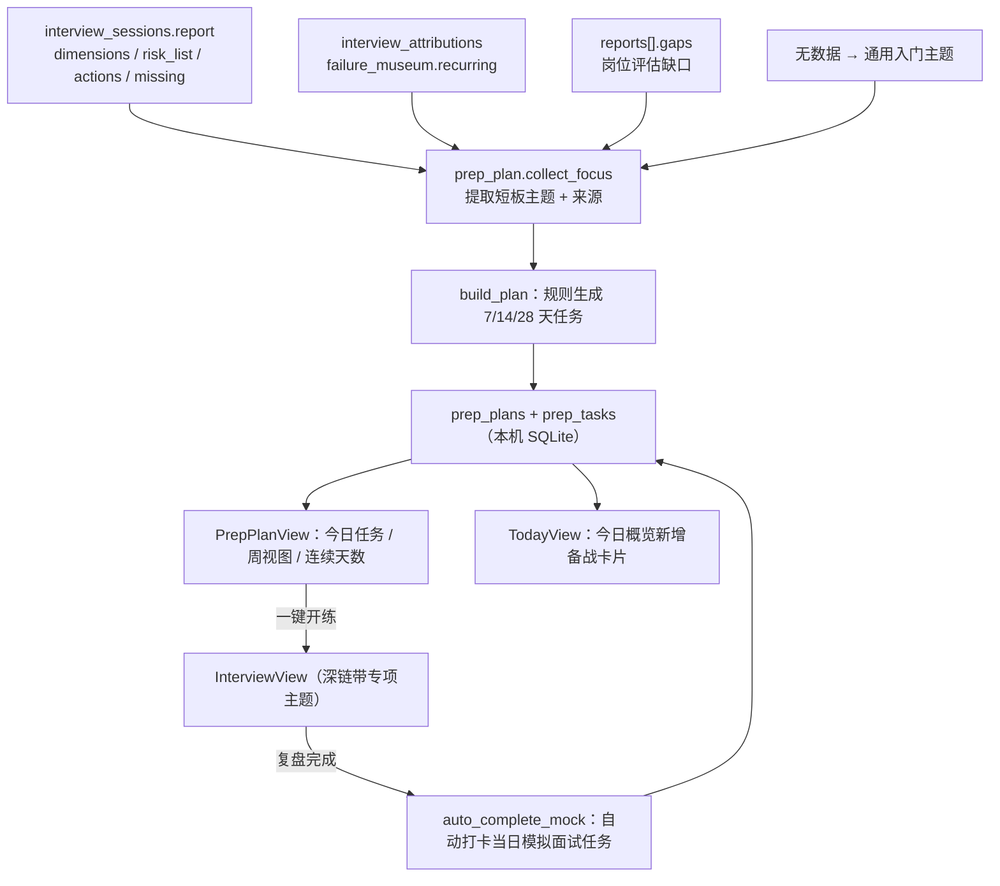

# 面试备战计划（Interview Prep Plan）设计

日期：2026-11-24。基线：当前工作区。实现模块：`backend/jobscope/prep_plan.py`、`backend/jobscope/main.py`、`frontend/src/PrepPlanView.tsx`。

## 1. 这个功能解决什么问题

失业求职者真正的焦虑往往不是「没有面试机会」，而是「机会来了接不住」。简历与投递管线已经能制造机会，但面试能力只能靠练；现实中又容易陷入「知道该学、就是不学」的怠惰循环。

现有产品里有一条完整的面试闭环（出题 → 对话 → 逐题复盘 → 归因 → 失败博物馆），也有一条「今日行动」清单（投递目标 + 处方卡）。但两者之间没有链路：**面试暴露的短板停在报告里，不会变成明天可以做的一件小事**。

本功能补的就是这条链路：

> 把本机已有的面试报告、归因记录与评估缺口，翻译成一份 14 天的每日备战计划；每天只摆出一两件小任务，其中一件固定是「刷一场模拟面试」；完成后打卡，连续天数给正反馈；漏做不清算、补做即可。

一句话定位：**本地单人自用的面试备战日程**——不联网、不排名、不评判人格，只回答「今天练什么」。

## 2. 设计原则

| 原则 | 具体做法 | 为什么 |
| --- | --- | --- |
| 只摆今天，不摆欠账 | 计划页首屏是「今天的 1–2 件事」，未来任务折叠在周视图里；逾期任务不标红催办，允许补做 | 欠账清单是怠惰的最大阻力，回来比补进度重要 |
| 任务小到无法拖延 | 每件事 ≤20 分钟，带明确验收标准（「90 秒讲完并录音回听」「写出 200 字要点和一个例子」） | 「补充学习某某知识」太抽象，必须落到可勾掉的颗粒度 |
| 一天一次模拟面试是锚点 | 每天固定一张必做的 `mock` 任务，从计划页一键进入面试间；复盘生成后自动打卡 | 用户明确点名的场景；闭环自动完成才不会漏打卡 |
| 证据可追溯 | 每条任务写清来源（哪场面试、哪个维度几分、哪条重复失分点）；模型输出也必须引用材料，不造事实 | 与项目既有口径一致：未知就留作未知 |
| 模型做分析，规则做排期 | 模型只产出诊断 + 3–6 个短板 + 每个短板的具体练法；日期、必做/选做、打卡闭环保持确定性 | 让计划真正个性化，同时不让模型抽风破坏任务结构 |
| 模型不可用可降级 | 未配置分析绑定、输出 JSON 无效或调用失败时退规则版，plan 标 `origin=rules`、前端标「规则模板」 | 不因模型抖动打不开计划；不伪装成 AI 定制 |
| 用户可自定义 | 备战重点、目标岗位、每日可投入时长、是否用模型都进 `prefs` 并参与幂等判断 | 「像写死的」是最大体验问题；重点和岗位必须能改变结果 |
| 温和语言 | 连续天数断了只说「中断很常见，今天重新开始」；不可控归因不进学习计划 | 失败博物馆已确立的口径：可控项给建议，不可控项只定位 |

## 3. 数据流

关键闭环：从计划页点「开始模拟面试」→ 面试结束生成报告 → 后端自动把当日 `mock` 任务标记为完成 → 回到计划页看到进度前进。用户不需要记住回来打卡。

## 4. 数据来源与提取规则

`collect_focus(repo)` 返回短板主题列表，每项含 `topic / detail / source / weight / kind_hint / session_id`。

| 来源 | 读取位置 | 提取规则 | 权重 | `kind_hint` |
| --- | --- | --- | --- | --- |
| 低分维度 | `report.dimensions[]` | `score <= 3` 的维度，主题 = 维度名，详情 = `comment` | 2 | study |
| 高危清单 | `report.risk_list[]` | 每条一项，截到 60 字 | 2 | drill |
| 复盘行动 | `report.actions[]` | 每条一项，截到 60 字 | 1 | drill |
| 逐题缺失 | `report.questions[].missing[]` | 归一为「补齐：<缺失项>」，同类合并 | 1 | drill |
| 重复失分点 | `failure_museum.build_pattern_report().recurring` | 出现 ≥2 次的可控标签，详情取 `advice` | **3** | drill |
| 岗位评估缺口 | `reports[].gaps[]` | 取最近有报告的岗位前 20 个，每个最多 2 条，截到 60 字 | 1 | study |
| 通用入门 | 代码常量 | 仅当上面全部为空：自我介绍 90 秒 / STAR 与量化 / 岗位核心知识 / 反问环节 / 空窗解释 | 0 | study |

- 去重：主题做归一（去空白与常见标点、转小写），同一主题只保留最高权重，来源说明最多拼 3 条。
- 排序：按权重降序，同权重按首次出现顺序；上限 `MAX_FOCUS = 6`。
- `created_from` 标记 `interview_report` / `failure_museum` / `jd_gaps` / `generic`，前端据此显示「依据来自哪里」。只有真的从模拟面试复盘里取到短板才标 `interview_report`；只有 JD 缺口时不得冒充面试报告。

## 5. 数据模型

在 `repository.py` 的建表脚本中追加两张表（沿用 `CREATE TABLE IF NOT EXISTS` + 显式列名的项目惯例）。日期统一取 `now()[:10]`（UTC 日历日），与 `pipeline_today_counts` 同口径。

### 5.1 `prep_plans`

| 列 | 类型 | 说明 |
| --- | --- | --- |
| `id` | TEXT PK | `P-<uuid4 hex>` |
| `status` | TEXT | `active` / `completed` / `archived`，同时只有一份 active |
| `days` | INTEGER | 7 / 14 / 28，默认 14 |
| `start_date` / `end_date` | TEXT | `YYYY-MM-DD`，起日为生成当天 |
| `created_from` | TEXT | 见上节 |
| `focus` | TEXT | 主题列表 JSON（含来源与权重） |
| `source_sessions` | TEXT | 参考的面试场次 id 列表 JSON |
| `created_at` / `updated_at` | TEXT | ISO 戳 |

### 5.2 `prep_tasks`

| 列 | 类型 | 说明 |
| --- | --- | --- |
| `id` | TEXT PK | `T-<uuid4 hex>` |
| `plan_id` | TEXT | 关联 `prep_plans.id` |
| `day_index` | INTEGER | 1..days |
| `date` | TEXT | 计划第 N 天对应的日历日 |
| `kind` | TEXT | `mock` / `study` / `drill` / `review` |
| `title` / `detail` | TEXT | 任务标题与可勾掉的操作说明 |
| `topic` | TEXT | 对应短板主题，深链带给面试间 |
| `minutes` | INTEGER | 预估分钟数（12–20） |
| `required` | INTEGER | 1 必做 / 0 选做 |
| `source` | TEXT | 证据来源说明（可回查） |
| `session_id` | TEXT | 关联的面试场次，可跳转回报告 |
| `job_id` | TEXT | 关联岗位（若有），深链进面试间时预选岗位 |
| `status` | TEXT | `pending` / `done` / `skipped` |
| `note` | TEXT | 完成备注，≤500 字 |
| `completed_at` / `created_at` | TEXT | ISO 戳 |

索引：`(plan_id, date)` 与 `(plan_id, status)`。

**迁移与自愈**：`job_id` 是初版建表后追加的列，既有库靠 `CREATE TABLE IF NOT EXISTS` 不会补列，必须在 `Repository.__init__` 里用 `PRAGMA table_info` + `ALTER TABLE` 显式迁移（已实现）。生成时计划头与任务在同一次事务里写入，避免列缺失等问题留下「有计划、0 任务」的空壳。万一历史库已有空壳计划，`snapshot()` 读取时会按计划里保存的 `focus` 幂等补齐任务——不重算短板、不改来源文案、不动已有打卡记录。

## 6. 任务生成规则

每天固定 2 件，第 7/14/21/28 天追加 1 件周复盘（最多 3 件）。主题按 `focus[(day_index - 1) % len(focus)]` 轮转，确保每个短板在一周内至少出现一次。

| `kind` | 出现频率 | 标题模板 | 验收标准（`detail`） | 必做 |
| --- | --- | --- | --- | --- |
| `mock` | 每天 | 完成一场模拟面试：<主题> | 开一场 6–8 题的模拟面试并读完复盘报告；专项考察「<主题>」，答完看报告里这一项的点评 | ✓ |
| `study` | 每天（当轮到主题 `kind_hint=study`） | 补一个知识点：<主题> | 找 1 份资料或笔记，写 200 字要点 + 1 个自己能讲出来的例子 | 选做 |
| `drill` | 每天（当轮到主题 `kind_hint=drill`） | 练一版表达：<主题> | 按 STAR 重写一版，补上 2 个数字；90 秒内讲完并回听一遍 | ✓ |
| `review` | 每 7 天 | 本周复盘：挑出还卡的一点 | 回看这周的报告，勾出仍薄弱的 1 点，下轮专项会优先练它 | 选做 |

- 无面试数据时，`mock` 任务仍每天出现（自由练模式），并在来源里写明「通用入门：本机还没有复盘数据，主题为通用建议」。
- 生成幂等：同一天重复点「生成」时，若已有 active 计划且其 `source_sessions` 摘要与当前一致，直接返回原计划，不产生第二份。
- 生成新计划会把旧 active 计划归档（`status='archived'`），历史任务和打卡记录保留，可回看。

## 6.5 模型个性化层（2026-11-24 第二轮）

`prep_plan_llm.py` 解决「像写死的」问题，但不接管排期：

- `prep_material(repo, focus, prefs)` 汇总最近两场面试报告摘要与低分维度、失败博物馆 recurring、目标岗位 JD 与评估缺口、简历摘要（`repo.resume()`）、启用的空窗条目（`gap_narrative.entries_block`）以及用户自填的 `goal / minutes_per_day`，各项都设字符上限。
- `analyze()` 复用 `analysis` 功能绑定与 `model_transport.complete()`（非流式，prompt 约定 JSON，两次尝试；剥围栏、抓 `{...}` 片段、软校验丢坏行）。输出 `diagnosis` + 3–6 项 `focus`（每项含 `topic/detail/source/drill/kind/weight`）。`source` 必须引用具体材料，`drill` 是 15 分钟内可完成的具体动作。
- 调用失败、未配置模型或有效 focus <2 项时返回 `None`，`build_plan()` 回退规则版并记 `origin='rules'`；成功则 `origin='model'`。前端据此显示「AI 定制 / 规则模板」，并显示诊断段。
- `_tasks_for()` 把模型给的 `drill` 写进练法任务的标题与详情，把 `diagnosis` 带进每周回看，其余节奏（每天 mock + 一件专项、每 7 天回看、必做/选做）不变。
- `prefs = {goal, job_id, minutes_per_day, use_llm}` 落 `prep_plans.prefs`，参与同日幂等；`use_llm=false` 强制规则版。计划头新增 `origin / diagnosis / prefs` 三列，既有库走 `ALTER TABLE` 迁移。

## 6.6 流式生成层（2026-11-24 第三轮）

生成从同步阻塞改为「后台 run + SSE」（`prep_plan_runs.py`，与 analyze/interview 同一套 RunHandle 事件日志模式；全局同时只允许一个活动 run）：

- 事件序列：`start → focus → model_start → diagnosis_delta… → model_done|model_fallback → focus_item… → scheduled → done|error → end`。`done` 携带完整快照（worker 先落库再推送）。
- 诊断逐字流式：`prep_plan_llm.analyze` 在提供 `on_delta` 时改走 `model_transport.stream_complete`，`DiagnosisProbe` 从流式 JSON 里渐进摘出 `diagnosis` 字符串值增量回调（探测只影响实时展示，正式内容仍由完整 JSON 解析产生；悬尾半个转义留到下一块，防死循环）。同步路径（`POST /api/prep-plan`）保持非流式。
- 快路径不起 run：同日幂等命中（`idempotent_plan` 抽出独立函数供 run 入口与 `generate` 共用，含「规则版可升级模型」判断）或 `use_llm=false`/模型未配置时同步生成、直接回快照（`run_id=null`）。
- 前端 `PrepPlanView` 生成时渲染渐进面板：三步清单逐项点亮、诊断文本打字机式浮现、短板 chips 逐条替换规则版清单；生成中途刷新/切页回来经快照里的 `active_run` 续接（SSE 从头重放重建进度）。不做取消：整条管线只有一次有超时上限的模型调用，中途放弃留不下任何计划。

## 6.7 对话式动态调整（2026-11-24 第四轮）

生成后计划不是死的：用户觉得不合理可以直接跟教练说，模型解释意图并产出结构化修改指令，规则层护栏落库——延续「模型做分析、规则做排期」的切分。

- 入口 `POST /api/prep-plan/adjust`（`PrepAdjustManager`，与生成共用 run+SSE 模式；生成与调整互斥，同时只允许一个活动 run）。一次流式调用同时产出：`===CHANGES===` 标记前的回复文本（逐字推 `delta` 给前端）+ 标记后的 JSON 指令数组（对用户隐藏，解析失败只丢指令不阻断回复）。
- 五类指令，`prep_plan.apply_adjustments` 逐条护栏执行：`set_prefs`（预算/重点/岗位；预算变化按同一口径重估全部 pending 的 drill/study 时长）、`edit_task` / `remove_task`（只动 pending，done/skipped 不动以保打卡记录）、`add_task`（day_index 必须在计划范围内）、`rebuild`（**不直接执行**：只落同批 `set_prefs`，其余丢弃，推 `confirm_required` 由用户在确认框点头后走 `force=True` 强制重新生成——覆盖类操作走 ConfirmDialog 是全站红线）。
- 多轮上下文挂在计划自己的 conversation（`prep_plans.conversation_id` 新列，既有库 `ALTER TABLE` 迁移）；每轮把「教练回复 + 已执行摘要」落库，递进说法（「再轻一点」）可用。先落库再推 `done`。
- `done` 携带 `{reply, applied, skipped, confirm_required, snapshot}`；快照 GET 带 `active_adjust` 供刷新续接。前端调整对话面板：轮次气泡 + 流式回复（打字机光标）+ applied 逐条亮出 + Enter 发送；未绑模型时输入框禁用并提示。
- `force=True` 重排继承当前计划已调整过的 prefs（对话 set_prefs 后的最新意图），不回落请求体缺省值；事件照走 §6.6 的生成管线。

## 7. 反怠惰机制

| 机制 | 实现 |
| --- | --- |
| 今日第一屏只看今天 | `GET /api/prep-plan` 返回 `today.tasks`（当天任务）与 `week`（折叠的周视图）；今日概览只显示一条摘要卡 |
| 连续天数 | 服务端按「当天有 ≥1 个必做任务 done」的日期集合计算；当天还没完成时从昨天起算，不打断当天节奏；断档只给温和文案 |
| 补做不惩罚 | 逾期任务仍可标完成，`completed_at` 记实际时间；连续天数按完成日期算，不按计划日期算 |
| 自动打卡 | 模拟面试复盘生成成功后，`auto_complete_mock()` 把当日未完成的必做 `mock` 任务标记完成；失败被吞掉并记日志，不影响面试流程 |
| 撤销误操作 | `done` / `skipped` 均可 `reopen`；不做不可逆确认弹窗（这类操作无破坏性） |
| 一键开练 | `mock` 任务按钮跳 `#/interview?job=<id>&focus=<主题>`；无岗位时只带 `focus`，面试间顶部显示专项提示 |
| 专项真的影响出题 | `focus` 经 `InterviewCreateInput.focus` 落进 `material.weak_focus`，接上 `interview.build_question_plan` 预留的第三层闭环：至少 1/3 的题围绕它展开，`source` 标 `weakness`；没带专项时行为不变 |

连续天数只作为正反馈展示，**不出排名、不设达标线、不生成「你落后了」一类判断**。

## 8. API 端点

全部注册在 `main.py` 的 `create_app()` 内，前缀 `/api/prep-plan`。

| 方法 | 路径 | 说明 |
| --- | --- | --- |
| GET | `/api/prep-plan` | 当前计划 + 今日任务 + 周视图 + 进度 + 历史计划摘要；无计划时 `plan=null`；生成中有 `active_run` 供前端续接 |
| POST | `/api/prep-plan` | 同步生成计划（body 可选 `days`）；同日同数据幂等返回原计划 |
| POST | `/api/prep-plan/runs` | 流式生成入口：幂等命中或规则快路径同步回快照（`run_id=null`），否则起后台 run 返回 `run_id`；`force=true` 跳幂等（整轮重排确认后） |
| GET | `/api/prep-plan/runs/{run_id}` | run 状态（done 标志） |
| GET | `/api/prep-plan/runs/{run_id}/stream` | SSE：从事件日志头部重放全部进度事件 |
| POST | `/api/prep-plan/adjust` | 对话式调整：`{message}` 起后台 run；无计划 404、未绑模型 400、生成/调整进行中 409 |
| GET | `/api/prep-plan/adjust/conversation` | 当前计划的调整对话历史（含已执行摘要） |
| GET | `/api/prep-plan/adjust/runs/{run_id}` | 调整 run 状态 |
| GET | `/api/prep-plan/adjust/runs/{run_id}/stream` | SSE：delta 逐字回复 + applied/skipped + confirm_required + done |
| POST | `/api/prep-plan/tasks/{task_id}/done` | 完成任务，可选 `note` |
| POST | `/api/prep-plan/tasks/{task_id}/skip` | 跳过任务 |
| POST | `/api/prep-plan/tasks/{task_id}/reopen` | 撤销完成/跳过，回到 pending |
| DELETE | `/api/prep-plan/{plan_id}` | 归档计划（不物理删除） |

## 9. 前端集成点

| 文件 | 改动 |
| --- | --- |
| `frontend/src/PrepPlanView.tsx`（新增） | 今日任务卡、周视图、进度条与连续天数、生成/归档入口、任务操作；生成时的流式进度面板（阶段清单 + 诊断逐字流 + 短板 chips）；生成后的对话调整面板（轮次气泡 + 流式回复 + applied 逐条结果 + rebuild 确认） |
| `frontend/src/navigation.ts` | `ViewId` 增加 `prep-plan`，导航组「岗位研究」加一项 |
| `frontend/src/App.tsx` | 视图装配、`main-compact` 分支、面包屑；`openInterview` 扩展支持 `focus` |
| `frontend/src/InterviewView.tsx` | `InterviewDeepLink` 增加 `focus`，新建面板顶部显示专项提示 |
| `frontend/src/TodayView.tsx` | 今日概览新增备战卡片（读 dashboard 返回的 `prep_plan`） |
| `frontend/src/api.ts` | 类型与请求封装；`Dashboard` 增加 `prep_plan` 字段 |
| `frontend/src/styles.css` | `pp-*` 样式族，沿用 `paper-panel` / `button` 等既有原子类 |
| `frontend/src/Tutorial.tsx` | `STEPS` 增补入口说明，`TUTORIAL_VERSION` 递增 |
| `frontend/src/Icon.tsx` | 新增 `target` 图标 |

确认类交互沿用 `ConfirmDialog`（归档计划用 `danger`）；任务的完成/跳过/撤销无破坏性，直接执行。

## 10. 边界与隐私

- 全部数据只存本机 SQLite；**只有用户主动勾选「用模型分析」且已配置「分析」绑定时**，才会把压缩后的材料（面试报告摘要、归因、岗位缺口、简历摘要、空窗条目、自填重点）发给该模型；可关闭该选项强制走规则版。规则版完全离线。
- 计划不读取 `runway_profile`（金额与社保等隐私，与面试备战无关），与 runway 模块的隔离约定一致。
- 计划任务不是能力评价：低分维度只表示本场报告里的具体失分点，不代表能力水平或录用概率。
- 无数据时给通用计划并明示；不虚构「根据你的薄弱项」这类无依据文案。
- 任务与备注有长度护栏（标题 120、详情 600、备注 500），防止异常数据撑爆列表。

## 11. 验证计划

- `backend/tests/test_prep_plan.py`：全部 `create_app(tmp_path)` 隔离，覆盖生成、幂等、来源提取、完成/跳过/撤销、连续天数、自动打卡、无数据回退、归档、护栏；流式生成另覆盖诊断探测器（跨块转义/围栏/键序）、阶段事件顺序、模型失败 `model_fallback` 降级、run 入口快路径与幂等、SSE 重放与活动 run 复用。
- `npm run build` 验证前端类型与打包。
- 集成验收按 `AGENTS.md`：8766 测试实例 + 独立 `JOBSCOPE_DATA_DIR`，不碰 8765 与 `.data/`。
